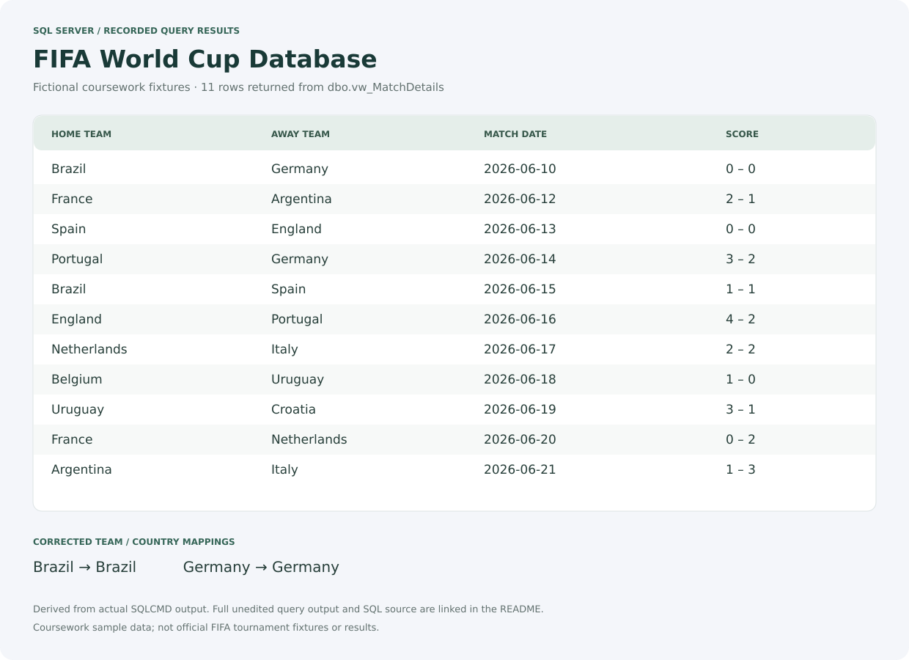

# FIFA World Cup Database

[](https://github.com/Nkosinathi-bit/FifaWC/actions/workflows/sql-check.yml)

**Academic group project · DBD2781 · Microsoft SQL Server / T-SQL**

A relational database coursework project modelling countries, cities, stadiums, teams, players, matches and ticket bookings. It demonstrates relational design, data validation and SQL reporting through a small tournament dataset.

The fixtures, scores, player selections and six-group structure are **fictional coursework examples**, not official FIFA 2026 tournament data. This repository contains SQL and documentation; it has no web application.

## Query results preview

These rows were returned by the maintained SQL scripts running on SQL Server. The image presents the recorded results as a readable table; the project has no graphical application.



[Full unedited SQLCMD output](docs/screenshots/query-output.txt) · [Capture provenance](docs/screenshots/capture.json)

## What the project demonstrates

- Seven related tables with primary keys, foreign keys, required fields and supporting indexes.
- A match-details view, a team-fixture stored procedure and a total-goals scalar function.
- Set-based score validation for inserts and updates.
- Duplicate-fixture protection, including reversed home/away teams, and unique seats per match.
- Joins, subqueries, CTEs, aggregate comparisons, CASE expressions and ranking.
- A transaction that rolls back its demonstration change and a cursor example.
- An optional database role/user example with read access limited to the Teams table.
- An optional copy-only backup script with an operator-supplied server path.

## Run the maintained version

Use a fresh development SQL Server instance (SQL Server 2022 is used in CI) and Microsoft's `sqlcmd` command-line utility. Run these commands **from the repository root** using Windows authentication:

```powershell
sqlcmd -S localhost -E -b -i setup.sql
sqlcmd -S localhost -E -b -i sql/04-transaction-cursor-demo.sql
sqlcmd -S localhost -E -b -i tests/verify.sql
```

Replace `localhost` with your development instance name. SQL-authenticated connections can use `-U` with the `SQLCMDPASSWORD` environment variable instead of placing a password in a script.

`setup.sql` uses SQLCMD include directives. In SQL Server Management Studio, enable **Query → SQLCMD Mode**, ensure the include paths resolve from the repository root, then run it on a development instance.

**Setup creates `FIFA2026` and stops if that database already exists. It never drops or overwrites an existing database.** Use a fresh instance to repeat the full setup. The individual schema and seed files are designed for a new database, not repeated migrations.

## Quick inspection

```sql
USE FIFA2026;
SELECT * FROM dbo.vw_MatchDetails ORDER BY MatchDate;
EXEC dbo.sp_GetMatchesByTeam @TeamID = 1;
SELECT dbo.fn_TotalGoals(2) AS TotalGoals;
```

The seed contains **15 countries, 13 cities, 13 stadiums, 12 teams, 22 players, 11 matches and 9 tickets**. Brazil and Germany reference their own country records.

## Repository guide

| Path | Purpose |
| --- | --- |
| `setup.sql` | Non-destructive entry point for a new database |
| `sql/00-session-options.sql` | Session settings required by indexed computed team-pair columns |
| `sql/01-schema.sql` | Tables, relationships, indexes, view, procedure, function and trigger |
| `sql/02-seed.sql` | Fictional coursework data |
| `sql/03-queries.sql` | Reporting and SQL query examples |
| `sql/04-transaction-cursor-demo.sql` | Transaction and cursor demonstrations |
| `sql/optional/security.sql` | Database-scoped, non-login reader demonstration |
| `sql/optional/backup.sql` | Copy-only backup with a SQLCMD `BackupPath` variable |
| `tests/` | Database integrity checks and a query preview |
| `docs/coursework-report.pdf` | Original group report, including the original ERD |
| `archive/FIFA2026-original.bak` | Historical submission backup, preserved for reference |

The SQL files are the maintained, reproducible version. The original PDF and backup describe the submitted coursework and may differ from subsequent corrections. The historical backup is not required for setup. Runtime logs and new backup files are ignored.

## Validation and scope

GitHub Actions creates a disposable SQL Server instance and checks row counts, country mappings, view/function output, invalid score inserts and updates, duplicate fixtures/seats, transaction rollback and refusal to rerun setup over an existing database.

The security example creates a user **without a login** and grants access through a database role. It does not create a server login or commit passwords. The maintained version does not claim to encrypt ticket data. The original submission created encryption keys but did not use them to encrypt ticket records.

## Group attribution

Original coursework by **Nkosinathi Mathenjwa, Zane Vincent Botha and Tsakani Mawelela (Group 13)**. The report is preserved with its original attribution. Maintenance, documentation and validation changes are recorded in Git history.
